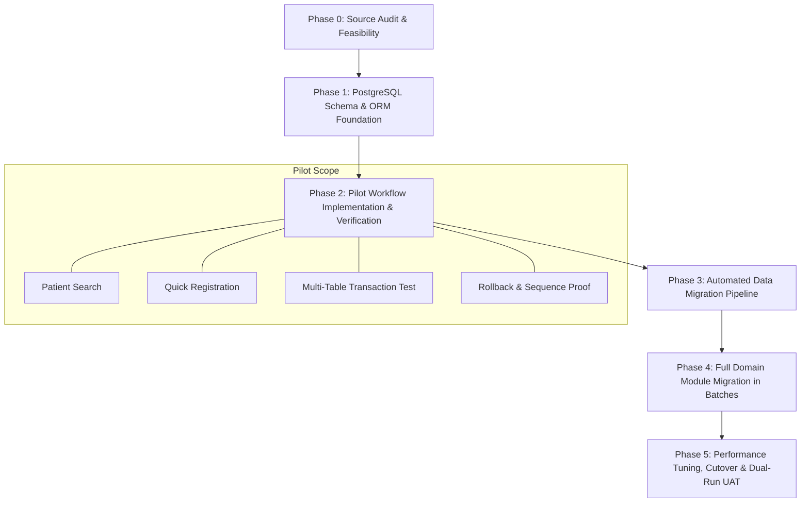
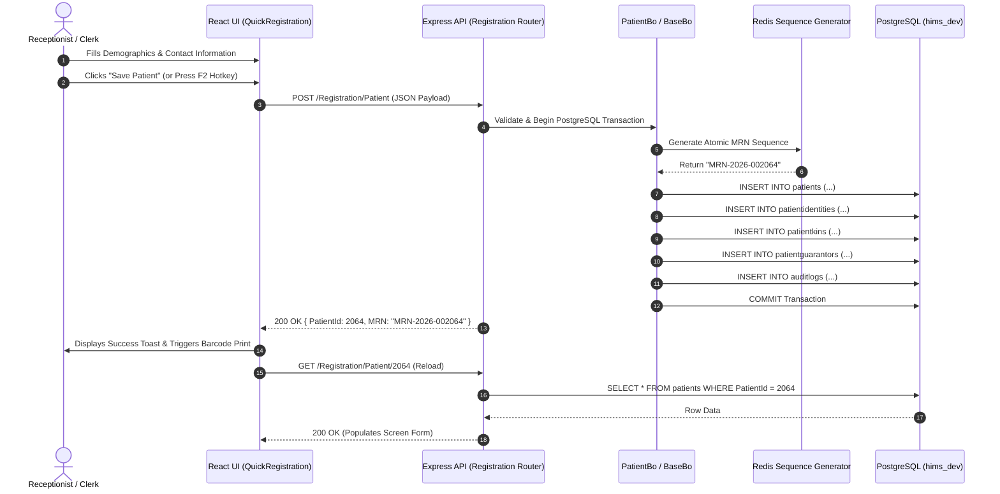

# Phase 0: MySQL to PostgreSQL Migration Execution Plan & Pilot Roadmap

**Document Version:** 1.0.0  
**Audit Date:** October 2, 2026  
**Status:** Approved for Phase 1 Execution  

---

## 1. Migration Overview & Strategy

This execution plan defines the systematic, risk-controlled migration strategy for transitioning the Hospital Information Management System (HIMS) from MySQL 5.7 to PostgreSQL 14 while establishing a separate new project codebase with 100% functional parity.

---

## 2. Phase-by-Phase Work Breakdown Structure (WBS)

### Phase 0: Discovery, Source Audit & Feasibility (COMPLETED)
- **Deliverables:**
  - `docs/migration/00-feasibility.md`
  - `docs/migration/01-source-inventory.csv` (4,830 source elements)
  - `docs/migration/02-screen-api-table-map.csv` (771 screen actions mapped)
  - `docs/migration/03-postgresql-compatibility.md`
  - `docs/migration/04-execution-plan.md`

---

### Phase 1: PostgreSQL Schema & Database Engine Setup
- **Milestone 1.1:** Initialize target PostgreSQL database `hims_dev` on Port 5432.
- **Milestone 1.2:** Generate PostgreSQL DDL for 554 base tables and 8 views with standard lowercase naming and proper foreign keys.
- **Milestone 1.3:** Setup PostgreSQL Sequelize connection adapter with connection pooling, statement timeouts, and type parsers (`BigInt`, `Numeric`, `Date`).
- **Milestone 1.4:** Implement automatic sequence reset script (`setval`) for primary keys.

---

### Phase 2: Pilot Workflow Implementation & Parity Testing
- **Milestone 2.1:** Implement backend Pilot APIs on PostgreSQL (`/Registration/Patient`, `/Registration/PatientSearch`, master lookups).
- **Milestone 2.2:** Connect Frontend React Quick Registration screen (`src/react-components/QuickRegistration.tsx`) to PostgreSQL-backed API.
- **Milestone 2.3:** Execute automated 6-step Pilot Verification Suite (UI Save $\rightarrow$ API Success $\rightarrow$ DB Verification $\rightarrow$ UI Reload $\rightarrow$ Permissions $\rightarrow$ Rollback).

---

### Phase 3: Data Migration Pipeline & ETL Automation
- **Milestone 3.1:** Build high-throughput data extraction and insertion script using Node.js streaming pipelines and PostgreSQL `COPY` / bulk batching.
- **Milestone 3.2:** Execute migration of master tables (titles, genders, relations, facilities, tariff masters, pincodes).
- **Milestone 3.3:** Implement data validation reconciliation engine comparing row counts, checksums, and date boundaries between MySQL and PostgreSQL.

---

### Phase 4: Batch Migration of Remaining Domain Modules
Modules will be migrated in cohesive dependency batches:
- **Batch 1 (Foundational):** General Masters, System Settings, User Auth, Roles & Permissions, Registration.
- **Batch 2 (Clinical Masters & OPD):** Clinical Masters, Doctor Master, Appointment Scheduling, Outpatient Visits.
- **Batch 3 (EMR & LIS):** Electronic Medical Records, Clinical Notes, Prescriptions, Orders, LIS Analyzer Interfaces.
- **Batch 4 (Billing & Finance):** Tariffs, Inpatient Packages, Cashier Billing, Receipts, Refunds, Corporate Tally Views.
- **Batch 5 (IPD, OT & Pharmacy):** Bed Management, Inpatient Admissions, Nursing, OT Management, Pharmacy Inventory & GRN.
- **Batch 6 (Ancillary & Background Jobs):** Asset Management, Discharge Summaries, Doctor Invoicing, Background Crons, External Gateways (WhatsApp, SMS, E-Invoice).

---

### Phase 5: Verification, Acceptance & Zero-Downtime Cutover
- **Milestone 5.1:** End-to-end automated regression testing across all 341 React screens.
- **Milestone 5.2:** Dual-run parallel validation in staging environment.
- **Milestone 5.3:** Final delta sync, sequence alignment, and production cutover to PostgreSQL.

---

## 3. Detailed Pilot Workflow Specification

### Selected Pilot Workflow: **Patient Registration & Patient Search**
Patient Registration is the mission-critical entry point for the entire hospital ecosystem. It exercises complex multi-table relationships, atomic sequences, identity document handling, and role permissions.

---

### 3.1 Pilot Dependency Matrix

#### Dependent Tables (18 Tables)
1. **Core Patient Tables:**
   - `patients` (Surrogate PK: `PatientId`, Business Key: `MRN`)
   - `patientidentities` (`PatientIdentityId`, `PatientId`, `IdentificationTypeId`, `IdentificationNumber`)
   - `patientkins` (`PatientKinId`, `PatientId`, `KinName`, `RelationId`, `Mobile`)
   - `patientguarantors` (`PatientGuarantorId`, `PatientId`, `GuarantorId`, `GuarantorTypeId`)
   - `patientguarantorgl` (`PatientGuarantorGLId`, `PatientId`, `GLNumber`, `GLDate`, `ExpiryDate`)
   - `patientattachments` (`PatientAttachmentId`, `PatientId`, `DocumentTypeId`, `FilePath`)
2. **Master Lookup Tables:**
   - `facilities` (`FacilityId`, `FacilityName`, `FacilityCode`)
   - `titles` (`TitleId`, `TitleName`, `GenderId`)
   - `genders` (`GenderId`, `GenderName`, `GenderCode`)
   - `relations` (`RelationId`, `RelationName`)
   - `identificationtypes` (`IdentificationTypeId`, `IdentificationTypeName`)
   - `guarantors` (`GuarantorId`, `GuarantorName`, `GuarantorCode`)
   - `guarantortypes` (`GuarantorTypeId`, `GuarantorTypeName`)
   - `occupations` (`OccupationId`, `OccupationName`)
   - `countries`, `states`, `cities`, `pincodemasters`
3. **Security & Audit Tables:**
   - `users` (`UserId`, `UserName`, `FacilityId`, `RoleId`)
   - `auditlogs` (`AuditLogId`, `EntityName`, `EntityId`, `Action`, `UserId`, `Timestamp`)

#### Dependent APIs
- `GET /GeneralMaster/Titles` — Master titles lookup
- `GET /GeneralMaster/Genders` — Master genders lookup
- `GET /GeneralMaster/IdentificationTypes` — ID types lookup
- `GET /GeneralMaster/PincodeMasters?pincode={code}` — Auto-fill city/state lookup
- `POST /Registration/Patient` — Transactional multi-table patient creation
- `PUT /Registration/Patient/:id` — Update demographic and contact info
- `GET /Registration/Patient/:id` — Load full patient details by ID
- `POST /Registration/PatientSearch` — Paginated search by MRN, Name, Phone, Aadhaar

---

## 4. Pilot Verification Test Suite

The pilot implementation will be certified using an automated, evidence-producing test script verifying the following 6 core assertions:

### Test Case 1: End-to-End UI Save $\rightarrow$ API 200 OK
- **Input:** Valid patient registration payload with demographics, next-of-kin, and national ID.
- **Expected Result:** HTTP 200 OK response returning valid `PatientId` and generated `MRN`.

### Test Case 2: PostgreSQL Row Integrity & Cascade Writes
- **Action:** Query PostgreSQL directly on Port 5432.
- **Verification:**
  - `SELECT COUNT(*) FROM patients WHERE PatientId = :id` $\rightarrow$ Returns 1 row.
  - `SELECT COUNT(*) FROM patientidentities WHERE PatientId = :id` $\rightarrow$ Returns matching identity rows.
  - `SELECT COUNT(*) FROM patientkins WHERE PatientId = :id` $\rightarrow$ Returns matching kin rows.
  - `SELECT COUNT(*) FROM patientguarantors WHERE PatientId = :id` $\rightarrow$ Returns matching guarantor row.
  - Verify timestamp precision and foreign key integrity.

### Test Case 3: UI Reload & State Consistency
- **Action:** Call `GET /Registration/Patient/:id` and render into React form.
- **Verification:** All form fields (First Name, Last Name, Phone, DOB, Gender, National ID) match the saved payload exactly.

### Test Case 4: Role-Based Permission Enforcement
- **Action:**
  - Attempt request with `CLERK_ROLE` $\rightarrow$ Allowed (200 OK).
  - Attempt request with unauthenticated token or read-only role $\rightarrow$ Rejected with `403 Forbidden` / `401 Unauthorized`.

### Test Case 5: Transaction Rollback on Failure (Atomicity Proof)
- **Action:** Inject an intentional schema error on child table write (e.g. invalid `RelationId = 999999` violating foreign key constraint).
- **Verification:**
  - API returns HTTP 400/500 with descriptive error.
  - `SELECT COUNT(*) FROM patients WHERE MRN = :generatedMRN` $\rightarrow$ **0 rows**.
  - No orphan records exist in `patients`, `patientidentities`, or `patientkins`.

### Test Case 6: Sequence Gap & Counter Validation
- **Action:** Verify that a rolled-back transaction does not corrupt the Redis sequence counter or cause key collisions on subsequent registrations.

---

## 5. Risk Mitigation & Rollback Protocol

| Risk Scenario | Action Plan | Rollback Trigger |
| :--- | :--- | :--- |
| **PostgreSQL Connection Exhaustion** | Set connection pool (`max: 20`, `idleTimeout: 30000`) and configure PgBouncer connection pooling. | Connection latency exceeds 500ms under load. |
| **Schema Inconsistency During Migration** | Automated schema validation diff script running before each module rollout. | Column type or nullability mismatch detected. |
| **Pilot Workflow Regression** | Rollback pilot API routes to MySQL data source via environment flag `USE_POSTGRES_PILOT=false`. | Any pilot test failure in CI/CD pipeline. |

---

## 6. Acceptance Criteria & Phase 1 Sign-Off

Phase 1 will be considered complete when:
1. PostgreSQL schema DDL executes cleanly for all 554 tables.
2. The Pilot Test Suite passes 100% of the 6 test cases against PostgreSQL 14.
3. Master lookup endpoints return identical payload structures to legacy MySQL APIs.
4. Zero downtime or performance degradation occurs on the existing operational MySQL system.
