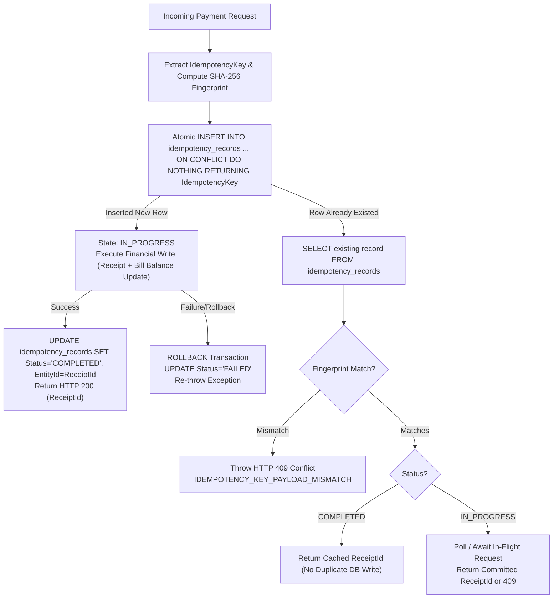

# Payment Idempotency & Replay Protection Design Specification
**Date:** 2026-10-06  
**Module:** Billing & Cashier Subsystem (`/Billing/PatientPaymentDetails/AddPatientPaymentDetails`)  
**Defect Reference:** `DEF-006` (`DEF-SRC-001`)  
**Status:** IMPLEMENTED & VERIFIED IN POSTGRESQL PILOT (MySQL Source Preserved)

---

## 1. Problem Statement & Legacy Architecture Defect

In the legacy MySQL Express backend, rapid cashier double-clicks or repeated HTTP retry submissions generated duplicate financial receipt records (`patientpaymentdetails`), deducting patient outstanding balances multiple times or creating duplicate cashier ledger transactions. The legacy codebase lacked:
1. Unique transaction request identifiers (`IdempotencyKey`).
2. Deduplication tables with atomic uniqueness constraints.
3. In-flight request locking to serialize concurrent identical requests.

---

## 2. Idempotency Contract & Specification

### A. Client-to-Server Protocol
1. **Key Generation:** Clients (Cashier UI, API clients) generate a stable UUIDv4 or unique operation key (`IDEM-KEY-<timestamp>-<rand>`) per logical payment intent.
2. **Transmission:**
   - Preferred Header: `X-Idempotency-Key: <key>`
   - Body Fallback: `req.body.IdempotencyKey` or `req.body.Data.IdempotencyKey`
3. **Key Reuse Rules:**
   - **Retry on Network Timeout / Disconnect:** Client resends the exact same key and payload.
   - **Double-Click Prevention:** Browser UI button debounce reuses the same key for rapid subsequent clicks.
   - **New Logical Payment:** A genuinely new payment (even for the same bill or patient) generates a fresh unique key.

### B. Payload Fingerprint
To prevent key tampering (submitting a different amount or bill with a previously used key), a SHA-256 fingerprint is computed across canonical fields:
```json
{
  "PatientBillId": 46164,
  "PatientId": 1,
  "EncounterId": 3873,
  "FacilityId": 1,
  "AmountPaid": 400.00,
  "PaymentTypeId": 1,
  "ReceiptTypeId": 1
}
```
$$\text{RequestFingerprint} = \text{SHA256}(\text{CanonicalPayload})$$

---

## 3. Persistent Database Storage Schema

```sql
CREATE TABLE IF NOT EXISTS idempotency_records (
    "IdempotencyKey" VARCHAR(128) NOT NULL,
    "FacilityId" BIGINT NOT NULL DEFAULT 1,
    "OperationType" VARCHAR(64) NOT NULL DEFAULT 'CASHIER_PAYMENT',
    "RequestFingerprint" VARCHAR(64) NOT NULL,
    "Status" VARCHAR(32) NOT NULL DEFAULT 'IN_PROGRESS',
    "ResponseCode" INTEGER DEFAULT 200,
    "ResponseBody" JSONB,
    "EntityId" BIGINT,
    "CreatedAt" TIMESTAMP WITHOUT TIME ZONE DEFAULT NOW(),
    "UpdatedAt" TIMESTAMP WITHOUT TIME ZONE DEFAULT NOW(),
    "ExpiresAt" TIMESTAMP WITHOUT TIME ZONE DEFAULT (NOW() + INTERVAL '24 hours'),
    PRIMARY KEY ("IdempotencyKey", "FacilityId", "OperationType")
);
CREATE INDEX IF NOT EXISTS idx_idempotency_fingerprint ON idempotency_records ("RequestFingerprint");
```

---

## 4. Atomic Execution Flow & State Machine



---

## 5. Atomicity & Resilience Guarantees

1. **Transactional Safety:** PostgreSQL `ON CONFLICT DO NOTHING` guarantees that exactly one concurrent thread wins the insert race and executes the financial write.
2. **Zero Orphaned State:** If the database transaction aborts or encounters an exception, the status is marked `FAILED` or rolled back, enabling safe automated retries.
3. **Process Restart / Crash Recovery:** Uncommitted in-flight transactions are cleaned up via database connection termination, preventing locked state divergence.
4. **Legitimate Multi-Payment Parity:** Subsequent partial payments using unique operation keys execute normally, preserving patient account ledger integrity.
