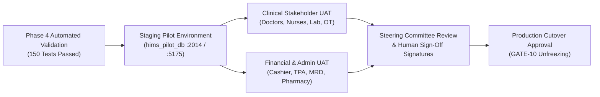

# Post-Automation Acceptance & Human UAT Execution Roadmap
**Date:** 2026-10-06  
**Status:** Pre-Cutover Verification Complete; Pilot Ready for User Acceptance Testing  
**Current Operating Mode:** Isolated Pilot Environment (`:2014` API / `:5175` UI / `hims_pilot_db`)

---

## 1. Executive Summary & Migration Milestones

| Verification Domain | Target Metric | Achieved Pilot Result | Status |
|:---|:---:|:---:|:---:|
| **Schema Migration** | 554 Base Tables + 8 Views | 554 Tables + 8 Views Created | **100% PARITY** |
| **Data Reconciliation** | 1,682,399 Records | 1,682,399 Records Reconciled (0 Loss) | **100% PARITY** |
| **Automated Functional Suites** | 19 Distinct Test Suites | 150 / 150 Tests Passed | **100% PASS** |
| **Financial & Idempotency** | Double-click, Tax math, Rollbacks | 6 Idempotency + 6 Tax/Rollback Tests Passed | **VERIFIED** |
| **Outbound Messaging Isolation** | External SMS / WhatsApp / Email | Offline / Mock Provider Interception Active | **SAFEGUARDED** |
| **Human Clinical & Financial UAT** | 10 Hospital Roles / 42 Workflows | Test sheets & synthetic fixtures staged | **PENDING USER SIGN-OFF** |
| **Production Cutover** | Live Database & DNS Switchover | Pre-requisite Human Sign-Offs Pending | **FROZEN** |

---

## 2. Human UAT Execution Schedule & Role Responsibilities

### Role-Based Test Plan Assignments

1. **Cashier / Billing Supervisor (`cashier1`):**
   - OP Billing creation with mixed tax-inclusive and tax-exclusive items.
   - Cash, Card, and UPI payment collections.
   - Verify double-click submission generates only 1 receipt.
   - Partial payments and deposit adjustments against advance funds.
   - Shift-end collection reconciliation reports.

2. **Consulting Physician (`doctor1`):**
   - OPD patient list lookup and consultation note entry.
   - ICD-10 diagnosis selection and vitals recording.
   - E-prescription generation and allergy checking.

3. **Ward In-Charge Nurse (`nurse1`):**
   - Inpatient bed allocation and room transfer workflows.
   - Nursing daily assessment notes and medication administration recording.
   - Discharge clearance workflow.

4. **Chief Pharmacist (`pharmacy1`):**
   - Prescription inwarding, dispensing, and batch deduction.
   - GRN goods receipt and stock transfer between central and sub-stores.

5. **Laboratory Officer (`labtech1`):**
   - Test master lookup, sample collection, barcode generation, and result entry.
   - Critical value alerts and report sign-off.

6. **OT In-Charge (`otadmin1`):**
   - Surgery scheduling, surgeon and anesthetist roster assignment.
   - Pre-operative checklist verification and intra-op notes.

7. **Insurance & TPA Coordinator (`insurance1`):**
   - Guarantee Letter (GL) limit entry and copay percentage setup.
   - Corporate package allocation and claim settlement recording.

8. **Medical Records Officer (`mrduser1`):**
   - Discharge summary archival, ICD-10 coding, file tracking, birth/death registry entry.

---

## 3. Pre-Cutover Readiness Gates Summary

- `GATE-01` (Schema Parity): **PASSED**
- `GATE-02` (Data Parity): **PASSED**
- `GATE-03` (View Relational Integrity): **PASSED**
- `GATE-04` (Security & Multi-Tenant Isolation): **PASSED**
- `GATE-05` (Financial Parity & Idempotency): **PASSED (AUTOMATED)** / **PENDING HUMAN UAT SIGN-OFF**
- `GATE-06` (Automated Functional Acceptance): **PASSED (150/150 Tests)**
- `GATE-07` (Performance & Scale): **PENDING PRODUCTION PGBOUNCER & LOAD STAGING**
- `GATE-08` (Third-Party Integrations): **PENDING PRODUCTION CREDENTIALS (MOCKED IN PILOT)**
- `GATE-09` (Human UAT Acceptance): **PENDING STAKEHOLDER SIGN-OFF**
- `GATE-10` (Production Cutover): **FROZEN**

---

## 4. Strict Operational Constraints

> [!CAUTION]
> 1. **No Production Database Overwrites:** The live MySQL 5.7 database (`localhost:3307/test`) remains read-only and untouched throughout all testing.
> 2. **Outbound Network Protection:** No SMS, WhatsApp, or external email notifications may be transmitted to live patient phone numbers.
> 3. **Human Sign-Off Requirement:** Automated test passes do not substitute for clinical and financial stakeholder approvals.
